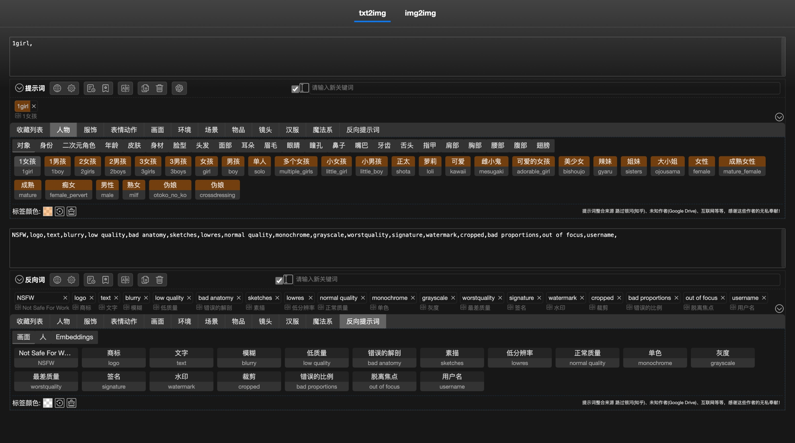

# Prompt All-in-One Web

<div align="center">

**日本語** | [简体中文](README_CN.MD)

</div>

Stable Diffusion のプロンプトを書く・整理する・翻訳するための Web アプリです。
**ブラウザで開くだけで使えます。** Python のインストールも、サーバーの起動も要りません。

👉 **https://tsubasatommy.github.io/sd-webui-prompt-all-in-one-app/**



[sd-webui-prompt-all-in-one](https://github.com/Physton/sd-webui-prompt-all-in-one) (Physton 氏) を、GitHub Pages の静的ページだけで動くように移植したものです。画面と操作は本家そのままです。

## できること

- プロンプトをタグ単位で編集 (重み付け・並べ替え・無効化・LoRA 表記など)
- キーワードグループ (人物・服装・表情・シーン…) からタグを追加
- 履歴とお気に入り
- 翻訳: 日本語などで入力して英語のプロンプトに、英語のタグを母語で表示
- tagcomplete 形式の翻訳 CSV の追加
- テーマの切り替え

## 翻訳

既定では **[PLaMo 3 Translate](https://huggingface.co/pfnet/plamo-3-translate-0.8b)** (Preferred Networks) を **ブラウザの中で** 動かします ([wllama](https://github.com/ngxson/wllama) / WebGPU)。

- 初回だけモデル (0.8B: 約 0.6GB / 2B: 約 1.4GB) を Hugging Face からダウンロードし、ブラウザにキャッシュします。2 回目以降はネットワークなしで翻訳できます。
- 翻訳する文章は端末の外に出ません。
- 対応言語は 53 言語です。PLaMo が対応していない言語 (ポルトガル語・トルコ語など) で使う場合は、最初から MyMemory が選ばれます。

翻訳設定では次のものも選べます (どれも任意)。

| 翻訳 API | 説明 |
| --- | --- |
| PLaMo 3 Translate (ローカルサーバー) | Ollama / LM Studio / llama-server で動かした PLaMo に接続します。2B / 8B など大きいモデルを使いたいとき向け。サーバー側で CORS を許可してください。 |
| OpenAI / Microsoft / Google Cloud / MyMemory | 各サービスへブラウザから直接リクエストします。 |

本家にあった無料翻訳 (スクレイピング系) や DeepL などは、ブラウザから直接呼べない (CORS) ため使えません。

## データの保存先

履歴・お気に入り・設定は **このブラウザの中 (IndexedDB)** にだけ保存されます。サーバーには送られません。

- 別の端末やブラウザとは同期されません。移すときは画面右上の **データ管理** から書き出して、移行先で読み込んでください。
- バックアップには、既定で API キーを含めません (チェックを入れたときだけ含めます)。
- Python 版の `storage` フォルダの `.json` ファイルをまとめて読み込めば、そのまま移行できます。
- ブラウザは空き容量が少なくなると、サイトのデータを消すことがあります。大事なデータは定期的に書き出してください。

> **API キーについて:** GitHub Pages では、同じオーナーのサイトがすべて同じオリジン (`<owner>.github.io`) を共有します。同じアカウントで公開している別のサイトからも、このサイトの保存データ (API キーを含む) を読めてしまいます。API キーを保存する場合は、独自ドメインで公開するか、同じアカウントに信頼できないページを置かないでください。

## 開発

必要なもの: Node.js 22.23.4 以上 (CI は `web/.nvmrc` の 24.11.1)

```bash
git clone --recurse-submodules https://github.com/TsubasaTommy/sd-webui-prompt-all-in-one-app.git
cd sd-webui-prompt-all-in-one-app/web
npm ci
npm run dev      # http://localhost:4321
npm run build    # web/dist に出力
```

### 構成

```
sd-webui-prompt-all-in-one/   本家 (サブモジュール)。直接は書き換えない
web/
  scripts/sync-aio.mjs        本家の Vue ソースとデータを web/ に取り込む (dev / build の前に自動実行)
  src/backend/                本家の Python サーバーの代わりにブラウザ内で動く実装
    gradioAPI.js              本家の src/utils/gradioAPI.js の差し替え (Vite の alias)
    store.js / history.js     保存 (IndexedDB)、履歴・お気に入り
    translate/                翻訳 (PLaMo ブラウザ版・ローカルサーバー・各種 API)
  src/app/                    起動処理、データ管理画面、進捗表示
  src/pages/index.astro       ページ本体 (Astro)
```

- 本家の Vue コンポーネントは Vue 3.2 前提なので、Vue は `3.2.47` に固定しています。
- 本家コードへの修正が必要な場合は、`sync-aio.mjs` の `PATCHES` でコピー側にだけ当てます。本家が変わってパッチが当たらなくなったら、ビルドが止まります。

### デプロイ

`main` に push すると [.github/workflows/pages.yml](.github/workflows/pages.yml) が GitHub Pages に公開します。サブモジュールを更新する「Create release」ワークフローが成功したときにも、公開し直します。

初回だけ、リポジトリの **Settings → Pages → Source** を **GitHub Actions** にしてください。

## Python 版 (従来の起動方法)

このリポジトリには、本家と同じ Python 版 (`app.py`) と Docker 構成も残しています。

```bash
pip3 install -r requirements.txt
python install.py
python app.py    # http://localhost:17860
```

Docker の場合は `docker-compose.yml` を参照してください。ポートやパスワードは `.env` (Docker では環境変数 `APP_PORT` / `APP_USERNAME` / `APP_PASSWORD`) で設定します。

## ライセンス

[MIT License](LICENSE)

- 本家 [sd-webui-prompt-all-in-one](https://github.com/Physton/sd-webui-prompt-all-in-one) / [sd-webui-prompt-all-in-one-app](https://github.com/Physton/sd-webui-prompt-all-in-one-app): © 2023 Physton (MIT License)
- PLaMo 3 Translate のモデルは [PLaMo Community License](https://huggingface.co/pfnet/plamo-3-translate-0.8b) です。モデルの重みはこのリポジトリに含まれず、利用時にブラウザが Hugging Face から直接ダウンロードします。
