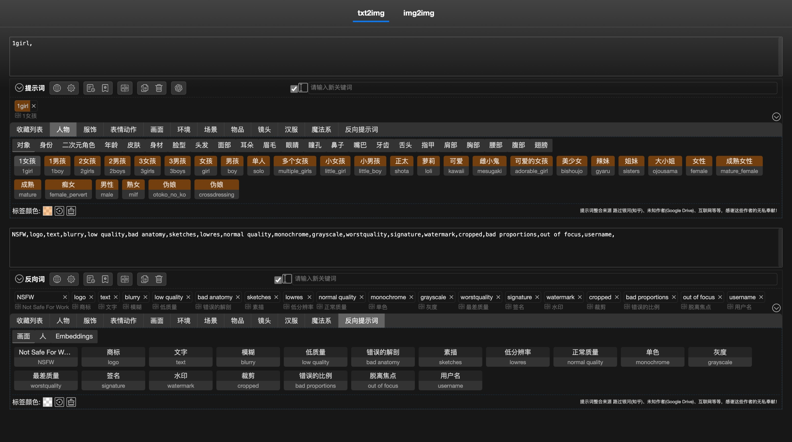

# Prompt All-in-One Web

<div align="center">

[日本語](README.MD) | **简体中文**

</div>

用于编写、整理和翻译 Stable Diffusion 提示词的 Web 应用。
**只需在浏览器中打开即可使用**，无需安装 Python，也无需启动服务器。

👉 **https://tsubasatommy.github.io/sd-webui-prompt-all-in-one-app/**



本项目将 [sd-webui-prompt-all-in-one](https://github.com/Physton/sd-webui-prompt-all-in-one)（作者 Physton）移植为仅靠 GitHub Pages 静态页面即可运行的版本，界面和操作与原版相同。

## 翻译

默认在**浏览器内**运行 **[PLaMo 3 Translate](https://huggingface.co/pfnet/plamo-3-translate-0.8b)**（[wllama](https://github.com/ngxson/wllama) / WebGPU）。

- 首次使用时从 Hugging Face 下载模型（0.8B 约 0.6GB / 2B 约 1.4GB）并缓存在浏览器中，之后无需联网即可翻译。
- 翻译内容不会离开你的设备。
- 支持 53 种语言。界面语言不受 PLaMo 支持时，默认使用 MyMemory。

也可以在翻译设置中选择：本地服务器上的 PLaMo（Ollama / LM Studio / llama-server）、OpenAI、Microsoft、Google Cloud、MyMemory。原版中的免费翻译接口（网页抓取类）和 DeepL 等无法从浏览器直接调用（CORS），因此不可用。

## 数据

历史记录、收藏和设置**只保存在当前浏览器中（IndexedDB）**，不会发送到服务器。

- 不会在设备或浏览器之间同步。迁移时请在右上角的「データ管理（Data）」中导出，再在新环境中导入。
- 备份默认不包含 API Key（勾选后才包含）。
- 可以直接导入 Python 版 `storage` 文件夹中的 `.json` 文件来迁移数据。

> **关于 API Key：** GitHub Pages 上同一所有者的所有站点共享同一个源（`<owner>.github.io`），同一账号下的其他站点也能读取本站保存的数据（包括 API Key）。如需保存 API Key，请使用自定义域名，或不要在同一账号下托管不可信的页面。

## 开发

需要 Node.js 22.23.4 以上。

```bash
git clone --recurse-submodules https://github.com/TsubasaTommy/sd-webui-prompt-all-in-one-app.git
cd sd-webui-prompt-all-in-one-app/web
npm ci
npm run dev      # http://localhost:4321
npm run build    # 输出到 web/dist
```

推送到 `main` 后，[.github/workflows/pages.yml](.github/workflows/pages.yml) 会自动发布到 GitHub Pages（首次需要在 Settings → Pages → Source 中选择 GitHub Actions）。

详细说明请参阅[日文版 README](README.MD)。

## 许可证

[MIT License](LICENSE)

- 原版 [sd-webui-prompt-all-in-one](https://github.com/Physton/sd-webui-prompt-all-in-one) / [sd-webui-prompt-all-in-one-app](https://github.com/Physton/sd-webui-prompt-all-in-one-app)：© 2023 Physton（MIT License）
- PLaMo 3 Translate 模型采用 [PLaMo Community License](https://huggingface.co/pfnet/plamo-3-translate-0.8b)。本仓库不包含模型权重，使用时由浏览器直接从 Hugging Face 下载。
